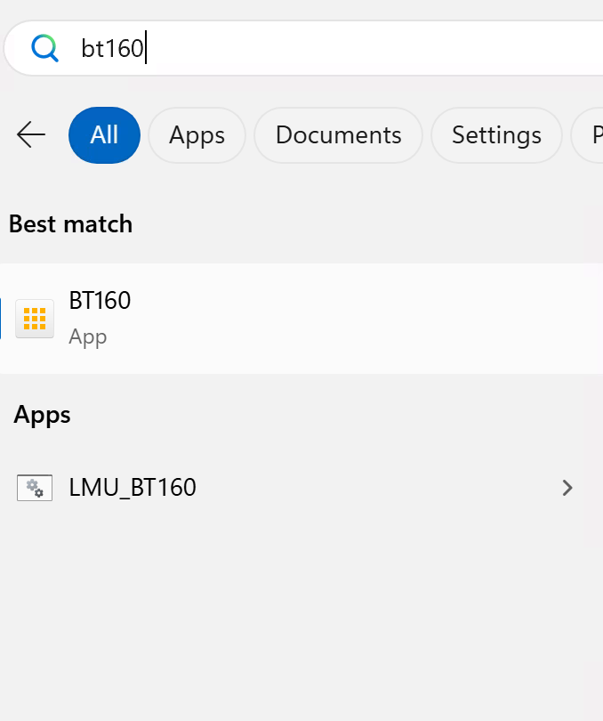

# Getting Started

## Overview

Before the exercises begin, prepare your laptop, open Claude Code, connect it to your SAP LeanIX workspace through the MCP server, log in to the workspace, and orient yourself. Everything you need for the review of MaMa-CRM is already waiting.

**Duration:** 15 minutes

## What is SAP LeanIX?

**SAP LeanIX** is SAP's enterprise architecture management platform — a single place for EA and IT governance teams to maintain an inventory of all applications, technologies, and data in their organization, track lifecycles, and connect the architecture landscape to business capabilities and strategy.

Two capabilities drive this workshop:

- The **EA Assistant** is a conversational AI inside SAP LeanIX. It reads fact sheets, traverses relationships, reasons over indexed documents, and performs live web research — all in natural language.
- The **MCP server** exposes your LeanIX workspace as tools that AI clients can call directly from your own tooling. When you create an architecture decision in Exercise 1 via Claude Code, the EA Assistant in Exercises 2–5 can immediately read and reason over it — the same data, two surfaces.

## Systems You Will Use

| System | Purpose |
|--------|---------|
| SAP LeanIX (your own workspace) | Where the review takes place — inventory, EA Assistant, and architecture decisions all live here. You are the admin of your own workspace. |
| Claude Code in VS Code | Connect to your LeanIX workspace via the MCP server and create a governed architecture decision in Exercise 1 |

## Step 1 — Prepare Your Laptop

Your session laptop needs a one-time setup so Claude Code can reach the internet through the venue's **hyperspace proxy**. **Do this before you open Claude Code or VS Code.**

1. Press the **Windows / Start** key.
2. Type **`bt160`**.
3. Under **Apps**, run **`LMU_BT160`** and let it finish.



> **Why this matters:** Without the proxy setup, Claude Code cannot authenticate or reach the LeanIX MCP server. If `LMU_BT160` does not appear or the setup fails, raise your hand before continuing.

## Step 2 — Open Claude Code in VS Code and Connect to LeanIX

**Visual Studio Code** is pre-installed on your session laptop with the **Claude Code extension**. Exercises 1 and 2 use Claude Code to talk to your LeanIX workspace through the MCP server — you set that connection up here, once.

### Open Claude Code in VS Code

1. Open **Visual Studio Code** from the Start menu or taskbar.
2. Click the **Claude Code** icon in the Activity Bar on the left side.
3. Sign in when prompted — your session card has the credentials.

### Connect to the LeanIX MCP Server

The LeanIX MCP server exposes your workspace — fact sheets, architecture decisions, inventory — as tools Claude Code can call. Connect it through the VS Code interface:

1. In the Claude Code panel, open the **MCP Servers** section (plug icon, or via the settings gear → MCP Servers).
2. Click **Add MCP Server**.
3. Enter the LeanIX MCP server URL from your session card:
   ```
   https://<workspace-subdomain>.leanix.net/services/mcp-server/v1/mcp
   ```
4. When asked for authentication, choose **OAuth / browser login**.
5. A browser window opens — sign in to your LeanIX workspace.
6. Return to VS Code. The `leanix` server should show as **Connected**.

> **Verify it works:** In the Claude Code chat, ask: *"Using the LeanIX MCP server, list the architecture decision templates available in this workspace."* You should see at least one template. If you get an error, check the URL on your session card.

> **Prefer the terminal?** You can connect via CLI instead, using a technical-user API token. Create a Technical User under **Administration → Technical Users**, copy the token, then run:
> ```bash
> claude mcp add --transport http leanix <MCP-URL> \
>   --header "Authorization: Token <API-TOKEN>"
> ```
> Both approaches give you identical workspace access. Note: the header value is `Token <API-TOKEN>`, not `Bearer`.

## Step 3 — Log In to Your SAP LeanIX Workspace

1. Open your browser and navigate to the **SAP LeanIX URL** on your session card. Each participant has their own workspace, so make sure you use *your* URL.
2. Sign in with the credentials provided on your card.
3. You should land on the SAP LeanIX home screen.

## Step 4 — Orient Yourself in the Workspace

Spend two minutes finding the four places you will work today:

- **Inventory** — the catalogue of all applications, IT components, and other fact sheets in the landscape. This is where the **MaMa-CRM** application fact sheet lives.
- **Architecture Decisions** — where governance decisions (ADRs) are recorded. You will create one here in Exercise 1 and reference it throughout.
- **EA Assistant** — the conversational AI in SAP LeanIX, reached via **More** (top header) → **EA Assistant**. It is available throughout the session and does most of the analytical work from Exercise 2 onward.
- **Workspace Files (AI Assistants)** — admin area where documents are uploaded so the EA Assistant can reason over them. For this workshop, two documents are already uploaded and indexed in your workspace:
  - `Application Review — Top 20 Criteria.pdf` — the standard you will review MaMa-CRM against
  - `mama-crm-arc42.pdf` — the architecture documentation for MaMa-CRM

> **Why this matters:** The EA Assistant can only reason over documents that have been indexed. Both documents above were indexed before the session, so the EA Assistant can already cite them — you do not need to upload anything.

## Step 5 — Take a First Look at MaMa-CRM

1. Open the **Inventory**.
2. Filter by **Application** type and open the **MaMa-CRM** fact sheet.
3. Skim it — lifecycle, business criticality, ownership, relations. Don't analyze it yet; just get a feel for what the Board is asking you to pass judgment on.

> **Do not change anything yet.** Exercise 1 starts with Claude Code already connected.

## Summary

Your laptop is set up, Claude Code is connected to your workspace via MCP, you are logged in, and you have found the inventory, architecture decisions, the EA Assistant, and the indexed workspace files. In Exercise 1, you will use Claude Code to explore MaMa-CRM and create the review standard as an Architecture Decision.

[Next: Exercise 1 — Create the Review Standard from Claude Code (via MCP)](../ex1/README.md)
