# Getting Started

## Overview

Welcome to BT160! Complete the steps below **in order** — each one builds on the last. By the end, your laptop is set up, Claude Code is connected to your LeanIX workspace, and you are ready to start the review. Don't jump ahead; the connection you establish in Step 2 is what every exercise depends on.

**Duration:** 15 minutes

## What is SAP LeanIX?

**SAP LeanIX** is SAP's enterprise architecture management platform — a single place for EA and IT governance teams to maintain an inventory of all applications, technologies, and data in their organization, track lifecycles, and connect the architecture landscape to business capabilities and strategy.

Two capabilities drive this workshop:

- The **EA Assistant** is the conversational AI built into SAP LeanIX — no setup required, it is already there when you log in. It reads fact sheets, traverses relationships, reasons over documents you index in the workspace, and performs live web research, all in natural language. It is designed for architects and business users working inside LeanIX.
- The **MCP server** exposes your LeanIX workspace as tools that any AI client can call from your own tooling. When you create an architecture decision in Exercise 1 via Claude Code, the EA Assistant in Exercises 2–5 can immediately read and reason over it — the same data, two surfaces, the same MCP server underneath both.

## Systems You Will Use

| System | Purpose |
|--------|---------|
| SAP LeanIX (your own workspace) | Where the review takes place — inventory, EA Assistant, and architecture decisions all live here. You are the admin of your own workspace. |
| Claude Code (VS Code extension or terminal) | Connect to your LeanIX workspace via the MCP server and create a governed architecture decision in Exercise 1 |

## Step 1 — Prepare Your Laptop

> [!NOTE]
> This step is specific to this TechEd session. The LMU script routes Claude Code through the venue's Hyperspace proxy. After the session, you can connect Claude Code to your own LeanIX workspace with any MCP-compatible LLM using your own API key — no proxy script needed.

Your session laptop needs a one-time setup so Claude Code can reach the LLM through the venue's **Hyperspace proxy**. **Do this before you open Claude Code or VS Code.**

1. Press the **Windows / Start** key.
2. Type **`bt160`**.
3. Under **Apps**, run **`LMU_BT160`** and let it finish.


> [!WARNING]
> If `LMU_BT160` does not appear or the setup fails, raise your hand before continuing.

## Step 2 — Open Claude Code and Connect to LeanIX

Exercises 1 and 2 use Claude Code to talk to your LeanIX workspace through the MCP server. You set that connection up here, once.

**You can use Claude Code in whichever way you prefer:**
- **VS Code extension** (recommended for most participants): Visual Studio Code is pre-installed on your session laptop with the Claude Code extension. Authentication uses a browser OAuth flow.
- **Terminal / CLI**: If you prefer working in the terminal, Claude Code is also available as a command-line tool.

Both give identical workspace access. Choose whichever feels more natural to you.

> [!NOTE]
> The facilitator will walk through the MCP server setup live at the start of the session. The instructions below are your reference — follow along as they demonstrate.

### Option A — VS Code Extension

#### Open Claude Code in VS Code

1. Open **Visual Studio Code** from the Start menu or taskbar.
2. Click the **Claude Code** icon in the Activity Bar on the left side.

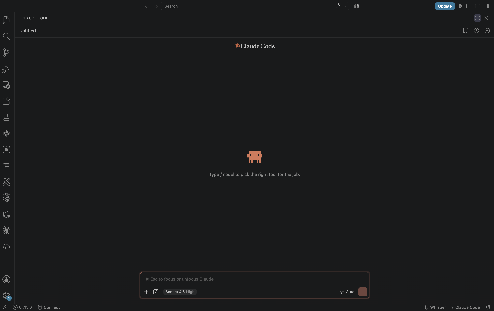

#### Connect to the LeanIX MCP Server

1. In the Claude Code chat input, type `/mcp` and select **MCP servers** under **Customize**.

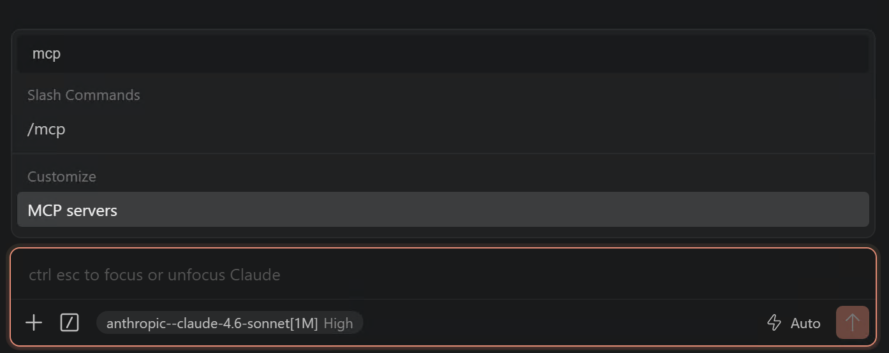

2. The **MCP servers** dialog opens. Click **Add server**.

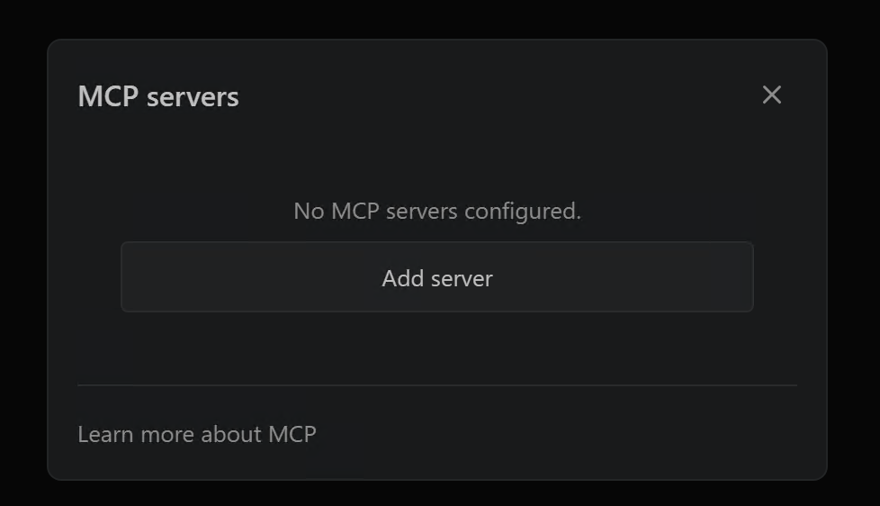

3. Fill in the form:
   - **Name**: `LeanIX`
   - **Transport**: **HTTP (remote)** — "Connects to a server by URL"
   - **URL** (replace `XX` with your participant number):
     ```
     https://mcp.leanix.net/services/mcp-server/v1/mcp/instance/de-8/workspace/BT160HandsOnXX
     ```
   - **Scope**: **User** (available in all your projects)
4. Click **Add server**.

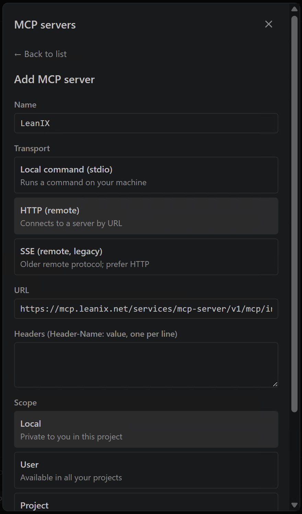

5. The server appears in the list with a **Needs Auth** badge. Click on **LeanIX** to open its detail view.

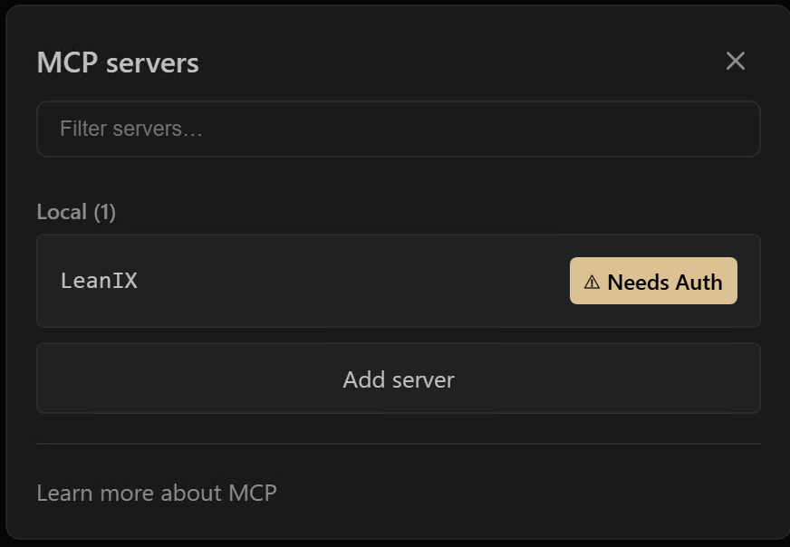

6. Click **Authenticate**.

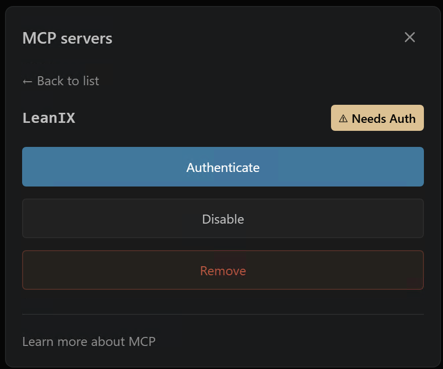

7. A browser window opens with the SAP LeanIX authorization page. Click **Consent**.

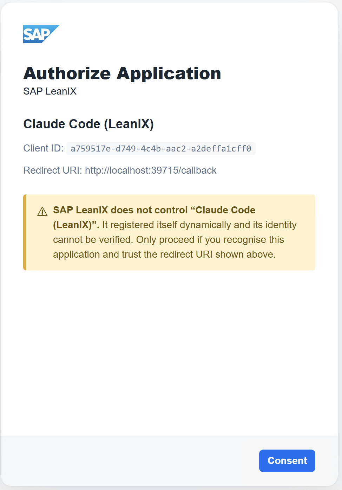

8. **Start a new chat** in Claude Code.

> [!IMPORTANT]
> The MCP server does not appear in the tool list until you open a fresh conversation. Start a new chat now — the server will not be available in the current one.

9. In the new chat, type `/mcp` → **Customize** → **MCP servers**. The `leanix` server should now show as **Connected**.

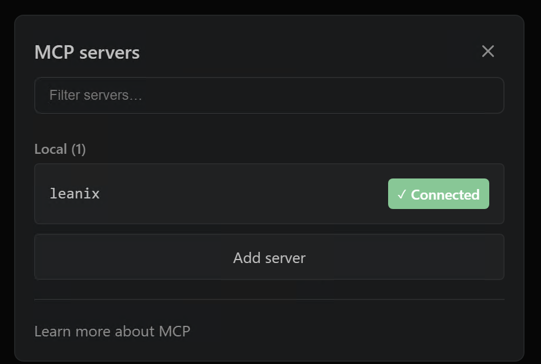

### Option B — Terminal / CLI

If you prefer the terminal, add the MCP server with a single command. Replace `XX` with your participant number:

```bash
claude mcp add --transport http leanix https://mcp.leanix.net/services/mcp-server/v1/mcp/instance/de-8/workspace/BT160HandsOnXX
```

Claude Code will open a browser window for OAuth login. Sign in to your LeanIX workspace and return to the terminal. Then **start a new chat** so the session picks up the authenticated server.

### ✅ Verify the connection works

⌨️ In the Claude Code chat, ask:

> *"Using the LeanIX MCP server, list the architecture decision templates available in this workspace."*

You should see at least one template. If you get an error, check the URL on your session card.

## Step 3 — Log In to Your SAP LeanIX Workspace

1. Open your browser and navigate to your LeanIX workspace. Replace `XX` with your participant number:
   ```
   https://de-8.leanix.net/BT160HandsOnXX/inventory
   ```
2. Sign in with the credentials provided during the session.
3. You should land on the SAP LeanIX home screen.

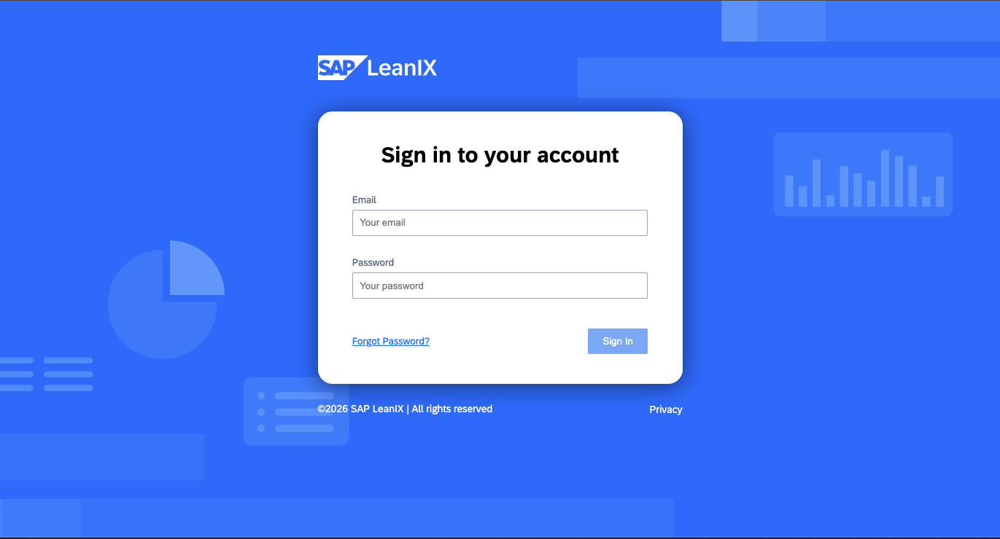

## Step 4 — Orient Yourself in the Workspace

Spend two minutes finding the four places you will work today:

- **Inventory** — the catalogue of all applications, IT components, and other fact sheets in the landscape. This is where the **MaMa-CRM** application fact sheet lives.
- **Architecture Decisions** — where governance decisions (ADRs) are recorded. You will create one here in Exercise 1 and reference it throughout.
- **EA Assistant** — the conversational AI in SAP LeanIX, reached via the **star icon** in the header toolbar, next to the **Full View** switcher. It is available throughout the session and does most of the analytical work from Exercise 2 onward.
- **Workspace Files (AI Assistants)** — admin area where documents are uploaded so the EA Assistant can reason over them. For this workshop, two documents are already uploaded and indexed in your workspace:
  - `Application Review — Top 20 Criteria.pdf` — the standard you will review MaMa-CRM against
  - `mama-crm-arc42.pdf` — the architecture documentation for MaMa-CRM

> [!NOTE]
> The EA Assistant can only reason over documents that have been indexed. Both documents above were indexed before the session, so the EA Assistant can already cite them — you do not need to upload anything.

To find the **EA Assistant**, click the star icon in the header toolbar, next to the **Full View** switcher:

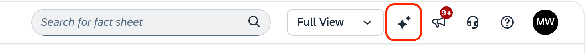

To find **Architecture Decisions**, open the **More** menu in the top navigation bar:

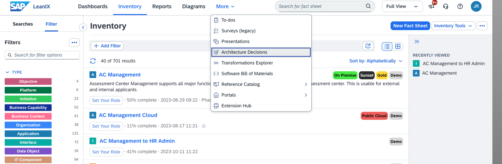

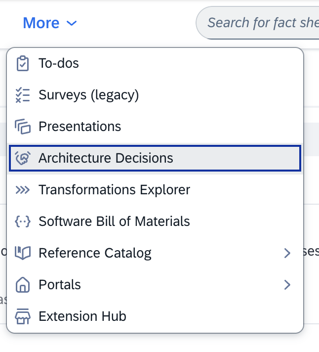

## Step 5 — Take a First Look at MaMa-CRM

1. Open the **Inventory**.
2. Filter by **Application** type and open the **MaMa-CRM** fact sheet.
3. Skim it — lifecycle, business criticality, ownership, relations. Don't analyze it yet; just get a feel for what the Board is asking you to pass judgment on.

> [!CAUTION]
> Do not change anything yet. Exercise 1 starts with Claude Code already connected.

## Summary

Your laptop is set up, Claude Code is connected to your workspace via MCP, you are logged in, and you have found the inventory, architecture decisions, the EA Assistant, and the indexed workspace files. In Exercise 1, you will use Claude Code to explore MaMa-CRM and create the review standard as an Architecture Decision.

[Next: Exercise 1 — Create the Review Standard from Claude Code (via MCP)](../ex1/README.md)
